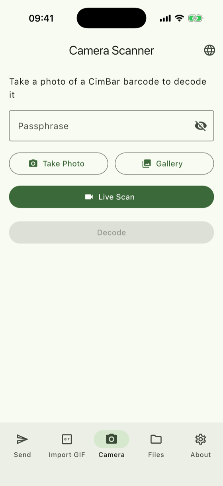
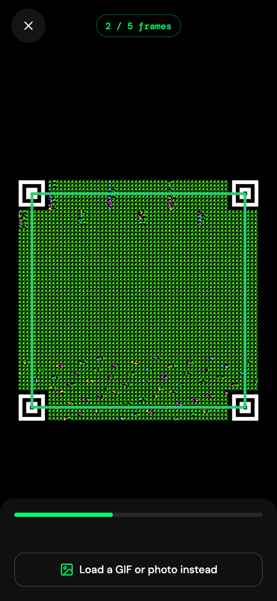
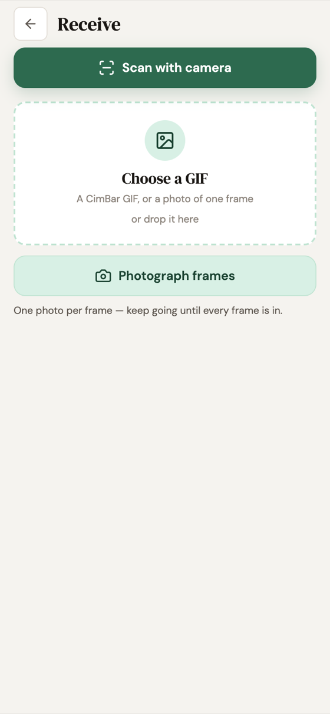
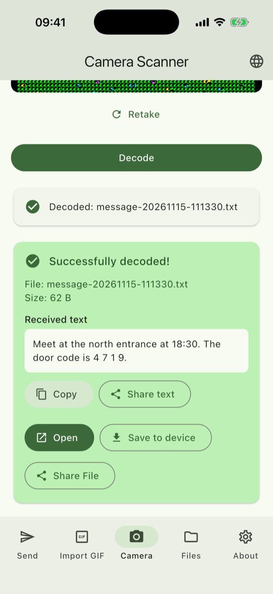
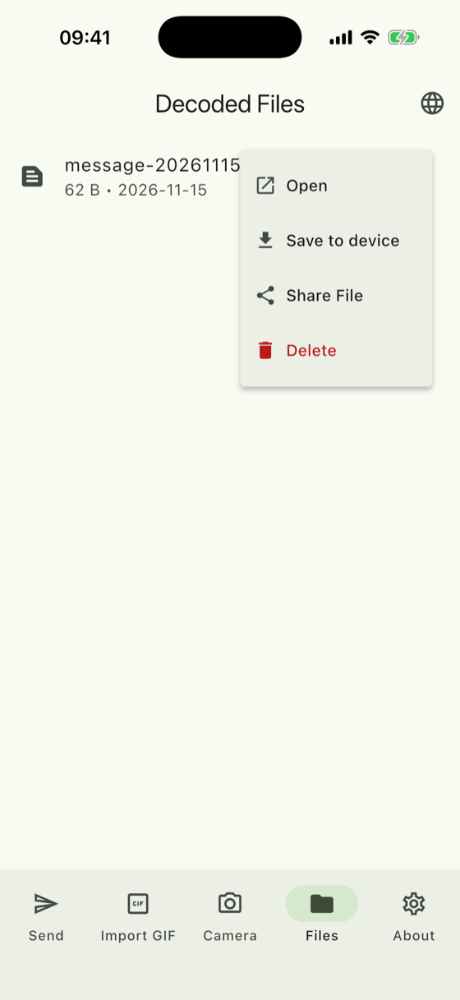
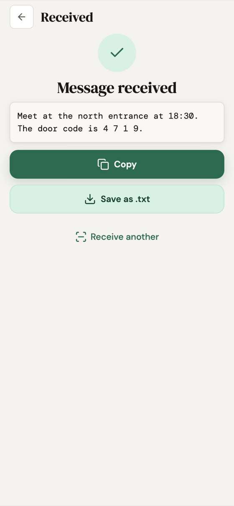

# Атрыманне

Ёсць тры спосабы атрымаць. Кожны заканчваецца аднолькава: файлам, які можна адкрыць, захаваць або перадаць, ці тэкставым паведамленнем, якое можна скапіяваць.

## Сканаванне камерай (рэкамендуецца)

Так атрымліваюць код, які нехта паказвае на экране.

**У праграме:** адкрыйце ўкладку **Камера** і націсніце **Жывое сканаванне**. **У вэб-праграме:** адкрыйце **Атрымаць**. Камера ўключыцца адразу.

1. Змясціце штрых-код у квадрат.
2. Выконвайце падказкі: **Падыдзіце бліжэй**, **Адсуньцеся далей**, **Трымайце нерухома**, **Змяніце вугал або асвятленне** (у вэб-праграме: **Трымайце камеру роўна насупраць экрана**).
3. Лічыльнік паказвае, колькі кадраў сабрана. Калі ён дасягне агульнай колькасці, файл адкрыецца.

Кадры могуць прыходзіць у любым парадку, а прапушчаныя кадры не маюць значэння: падыдуць любыя кадры файла, абы іх было дастаткова.

{ width="280" }
{ width="280" }

## Імпарт GIF

Калі з вамі падзяліліся GIF з кодам CimBar:

- **Праграма:** адкрыйце ўкладку **Імпарт GIF** і націсніце **Выбраць файл** або перашліце GIF з іншай праграмы адразу ў CimBar (праз меню «Падзяліцца» на Android або на iPhone).
- **Вэб-праграма:** у раздзеле **Атрымаць** націсніце **Выберыце GIF** (або перацягніце файл на старонку).

## Фота кадра

- **Праграма:** на ўкладцы **Камера** націсніце **Зрабіць фота** або выберыце здымак у раздзеле **Галерэя**. На фота змяшчаецца адзін кадр, таму так можна прыняць толькі код з аднаго кадра. Для даўжэйшага кода праграма прапануе **Жывое сканаванне**.
- **Вэб-праграма:** **Сфатаграфаваць кадры** прымае па адным фота на кадр і працягвае збіраць, пакуль не збяруцца ўсе кадры. Фота кадра можна дадаць і праз **Выберыце GIF**.

Калі фота належыць не таму файлу, які вы збіраеце, вэб-праграма спытае, перш чым пачаць нанова.

{ width="280" }

## Зашыфраваныя файлы

Калі файл зашыфраваны, пароль спытаюць, калі збяруцца ўсе кадры. Сканаваць зноў не трэба: калі пароль уведзены няправільна, проста ўвядзіце яго яшчэ раз. Гл. [Шыфраванне](encryption.md).

## Куды трапляюць атрыманыя файлы

**Праграма:** атрыманы файл захоўваецца ў праграме і бачны на ўкладцы **Файлы**. Адтуль яго можна **Адкрыць** у іншай праграме, **Захаваць на прыладу**, перадаць або **Выдаліць**. Тэкставае паведамленне паказваецца з кнопкамі **Капіяваць** і **Падзяліцца тэкстам**. Пры выдаленні праграмы выдаляюцца і захаваныя ў ёй файлы, таму загадзя захавайце патрэбныя.

**Вэб-праграма:** нічога не спампоўваецца аўтаматычна. Выберыце **Захаваць на прыладу**, **Адкрыць** (для тыпаў файлаў, якія бяспечна паказваць) або **Падзяліцца**. Тэкставае паведамленне паказваецца з кнопкамі **Капіяваць** і **Захаваць як .txt**.

{ width="220" }
{ width="220" }
{ width="220" }
