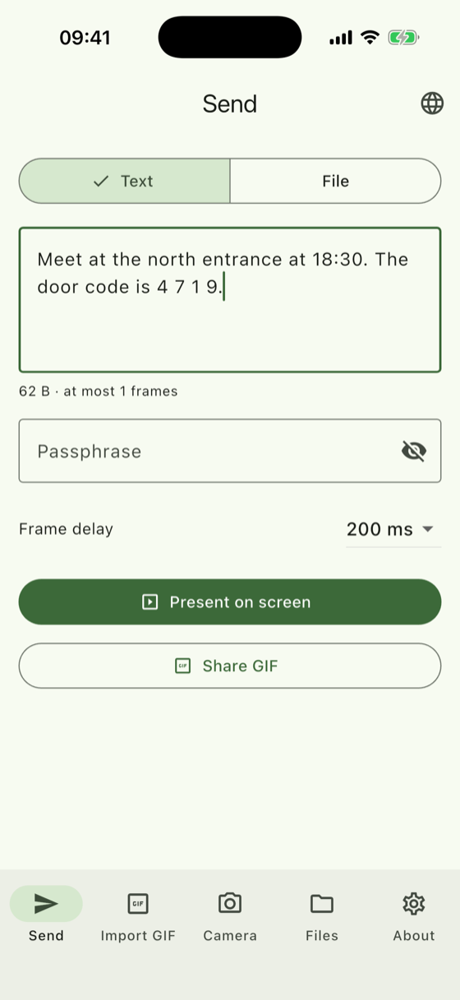
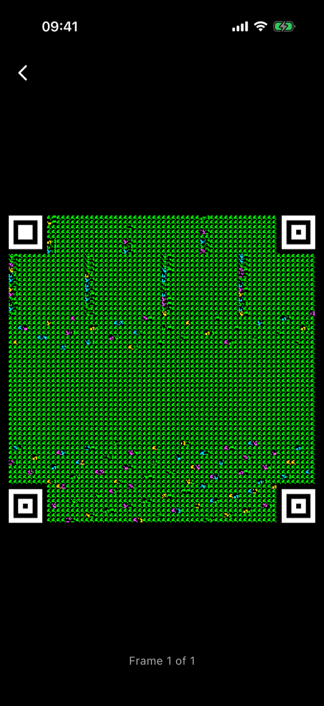
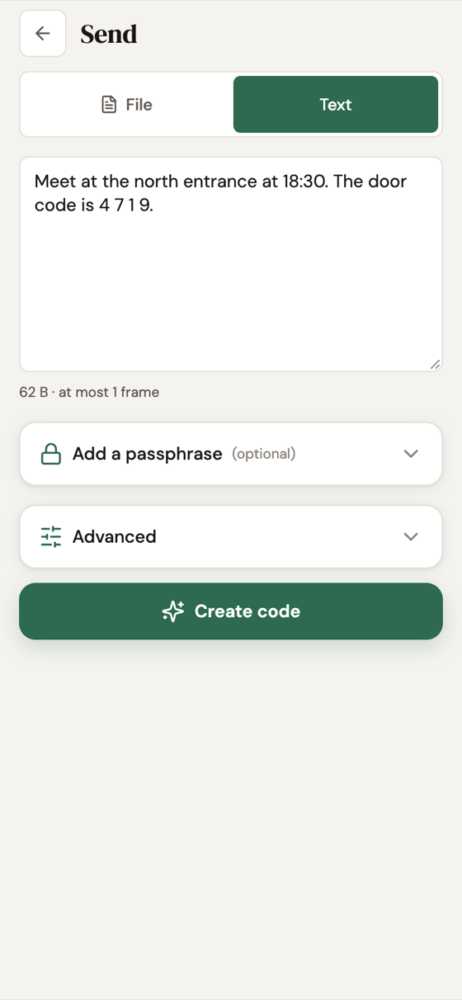
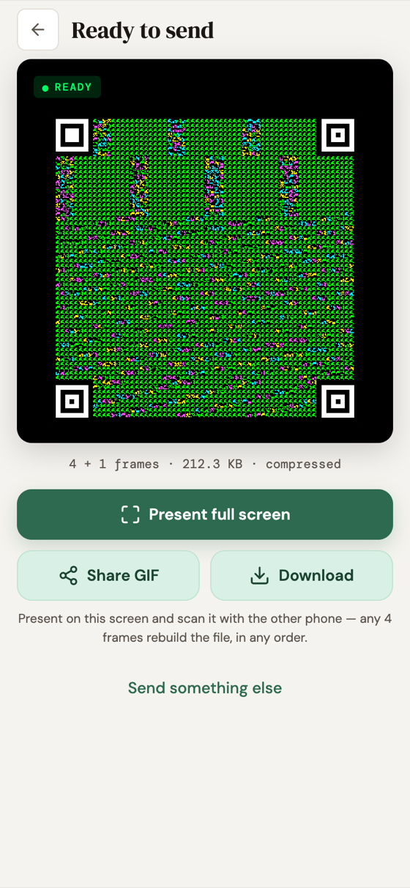

# Адправіць файл або тэкст

Адпраўка ператварае файл або паведамленне ў аніміраваны код: паслядоўнасць кадраў, кожны з якіх — сетка каляровых фігур. Пакажыце яго на ўвесь экран, каб іншая прылада адсканавала яго, або падзяліцеся ім як GIF.

## У праграме (Android, iPhone)

1. Адкрыйце ўкладку **Адправіць**.
2. Выберыце **Тэкст** і ўвядзіце або ўстаўце паведамленне ці выберыце **Файл** і пазначце файл.
3. Пры жаданні: увядзіце **Пароль**. Ён спатрэбіцца атрымальніку, каб адкрыць адпраўленае. Гл. [Шыфраванне](encryption.md).
4. Пры жаданні: змяніце параметр **Затрымка кадра**: 100, 200 або 400 мс на кадр. Павольней — лягчэй для камеры атрымальніка; хутчэй — хутчэй скончыцца.
5. Націсніце **Паказаць на экране**, каб вывесці код на ўвесь экран, або **Падзяліцца GIF**, каб адправіць яго як аніміраваны GIF праз іншую праграму.

Радок пад полем уводу паказвае памер і максімальную колькасць кадраў у кодзе.

Падчас паказу праграма не дае экрану гаснуць і павялічвае яркасць. Пасля выхаду ўсё вяртаецца як было.

{ width="280" }
{ width="280" }

## У вэб-праграме

1. Адкрыйце **Адправіць**.
2. Выберыце **Файл** (выберыце або перацягніце файл) або **Тэкст** (увядзіце паведамленне).
3. Пры жаданні: **Дадаць пароль**.
4. Пры жаданні: у раздзеле **Дадаткова** выберыце **Хуткасць кадраў**.
5. Націсніце **Стварыць код**. На экране **Гатова да адпраўкі** выберыце **Паказаць на ўвесь экран**, **Падзяліцца GIF** (на тэлефонах, якія падтрымліваюць адпраўку) або **Спампаваць**.

{ width="280" }
{ width="280" }

## Не спыняйце паказ

Паказаны код спачатку адзін раз праходзіць па ўсіх кадрах файла, а потым бясконца паказвае *кадры аднаўлення*. Атрымальніку патрэбна столькі кадраў, колькі іх у файле, і падыдуць любыя. Прапушчаны кадр замяняе той, які прыйдзе наступным, таму чакаць новага круга не трэба. Проста трымайце код на экране, пакуль атрымальнік не скажа, што ўсё гатова.

GIF нясе кадры файла і прыкладна на чвэрць больш кадраў аднаўлення, таму атрымальнік можа прапусціць некалькі кадраў на кожным праходзе.

## Наколькі вялікім ён можа быць?

Кожны кадр нясе каля 2 КБ. CimBar сціскае адпраўленае заўсёды, калі гэта змяншае памер, таму тэксту звычайна патрэбна менш кадраў, чым можна меркаваць па яго памеры.

- Невялікія файлы (прыкладна да 80 КБ) перадаюцца хутчэй за ўсё: некалькі дзясяткаў кадраў.
- **Паказаць на экране** спраўляецца з кодамі да 4096 кадраў.
- **Падзяліцца GIF** у праграме абмежавана 500 кадрамі.

Вялікія файлы таксама працуюць, але скануюцца доўга. Для кодаў больш чым прыкладна са 100 кадраў выбірайце павольнейшую хуткасць кадраў.
