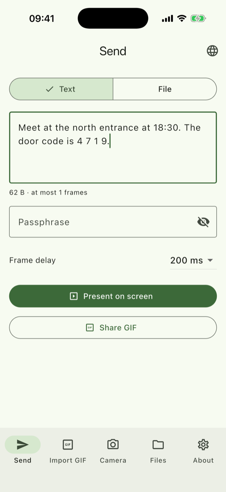
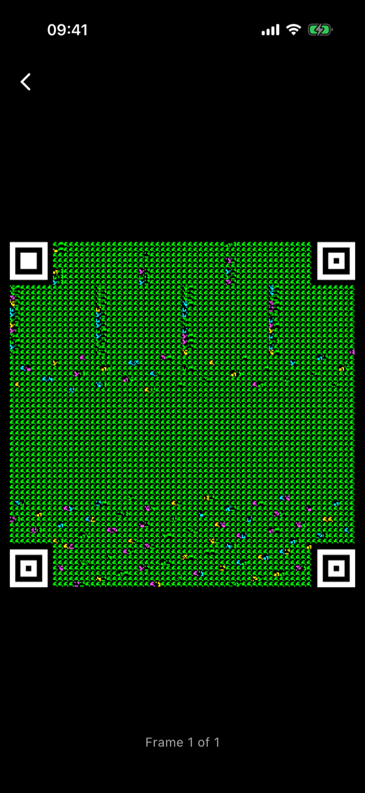
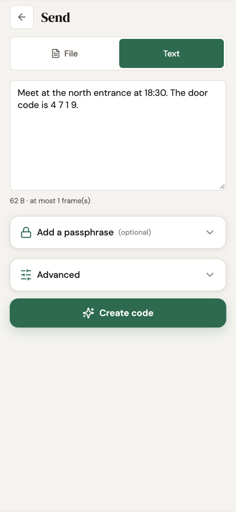
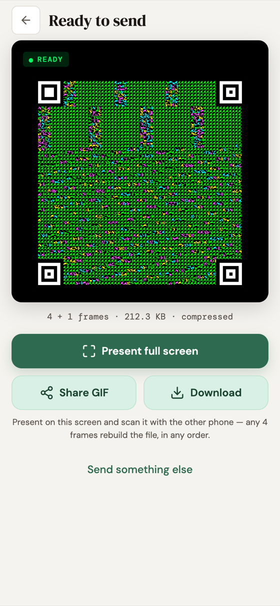

# ფაილის ან ტექსტის გაგზავნა

გაგზავნა ფაილს ან შეტყობინებას ანიმაციურ კოდად აქცევს: კადრების მიმდევრობად, რომელთაგან თითოეული ფერადი ფიგურების ბადეა. აჩვენეთ ის სრულ ეკრანზე და მისცეთ სხვა მოწყობილობას მისი დასკანერება, ან გააზიარეთ GIF-ის სახით.

## აპში (Android, iPhone)

1. გახსენით **გაგზავნა** ჩანართი.
2. აირჩიეთ **ტექსტი** და აკრიფეთ ან ჩასვით შეტყობინება, ან აირჩიეთ **ფაილი** და მიუთითეთ ფაილი.
3. სურვილისამებრ: შეიყვანეთ **პაროლი**. მიმღებს ის გაგზავნილის გასახსნელად დასჭირდება. იხილეთ [დაშიფვრა](encryption.md).
4. სურვილისამებრ: შეცვალეთ **კადრის დაყოვნება**: 100, 200 ან 400 ms კადრზე. ნელი ტემპი მიმღები კამერისთვის უფრო ადვილია, სწრაფი კი უფრო მალე სრულდება.
5. შეეხეთ **ეკრანზე ჩვენება**-ს, რომ კოდი სრულ ეკრანზე აჩვენოთ, ან **GIF-ის გაზიარება**-ს, რომ ის ანიმაციური GIF-ის სახით სხვა აპით გაგზავნოთ.

შეყვანის ველის ქვემოთ ხაზი აჩვენებს ზომას და იმას, მაქსიმუმ რამდენი კადრი ექნება კოდს.

ჩვენებისას აპი ეკრანს ჩართულს ტოვებს და სიკაშკაშეს ზრდის. გასვლისას ორივე ჩვეულ მდგომარეობას უბრუნდება.

{ width="280" }
{ width="280" }

## ვებ-აპში

1. გახსენით **გაგზავნა**.
2. აირჩიეთ **ფაილი** (აირჩიეთ ან ჩააგდეთ ფაილი) ან **ტექსტი** (აკრიფეთ შეტყობინება).
3. სურვილისამებრ: **პაროლის დამატება**.
4. სურვილისამებრ: **დამატებით** განყოფილებაში აირჩიეთ **კადრების სიჩქარე**.
5. შეეხეთ **კოდის შექმნა**-ს. ეკრანზე **გასაგზავნად მზადაა** აირჩიეთ **სრულ ეკრანზე ჩვენება**, **გაზიარება** (ტელეფონებზე, რომლებიც გაზიარებას უჭერენ მხარს) ან **ჩამოტვირთვა**.

{ width="280" }
{ width="280" }

## ნუ შეაჩერებთ

ნაჩვენები კოდი ჯერ ფაილის ყველა კადრს ერთხელ აჩვენებს, შემდეგ კი უსასრულოდ აჩვენებს *აღდგენით კადრებს*. მიმღებს იმდენი კადრი სჭირდება, რამდენიც ფაილს აქვს, და ნებისმიერი მათგანი გამოდგება. გამოტოვებულ კადრს ნებისმიერი მომდევნო კადრი ანაზღაურებს, ასე რომ, ციკლის თავიდან დაწყებას ლოდინი არ სჭირდება. უბრალოდ დატოვეთ კოდი ეკრანზე, სანამ მიმღები არ გეტყვით, რომ დასრულდა.

GIF ფაილის კადრებს და დამატებით დაახლოებით მეოთხედით მეტ აღდგენით კადრს შეიცავს, ასე რომ, მიმღებს ყოველ გავლაზე რამდენიმე კადრის გამოტოვება შეუძლია.

## რა ზომის შეიძლება იყოს?

თითოეული კადრი დაახლოებით 2 KB-ს ატარებს. CimBar გასაგზავნს კუმშავს, როცა ეს მას პატარავებს, ამიტომ ტექსტს, როგორც წესი, იმაზე ნაკლები კადრი სჭირდება, ვიდრე მისი ზომიდან გამომდინარეობს.

- პატარა ფაილები (დაახლოებით 80 KB-მდე) ყველაზე სწრაფია: რამდენიმე ათეული კადრი.
- **ჩვენება** 4096 კადრამდე უმკლავდება.
- აპში **GIF-ის გაზიარება** 500 კადრით შემოიფარგლება.

დიდი ფაილებიც მუშაობს, მაგრამ მათ სკანირებას დრო სჭირდება. დაახლოებით 100 კადრზე მეტი კოდისთვის აირჩიეთ კადრების უფრო ნელი სიჩქარე.
