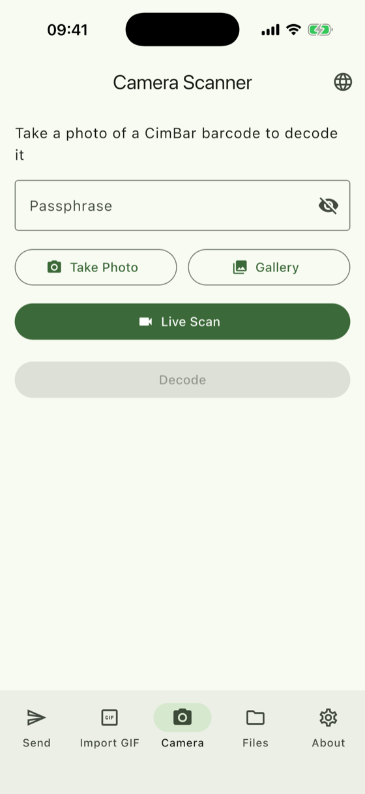
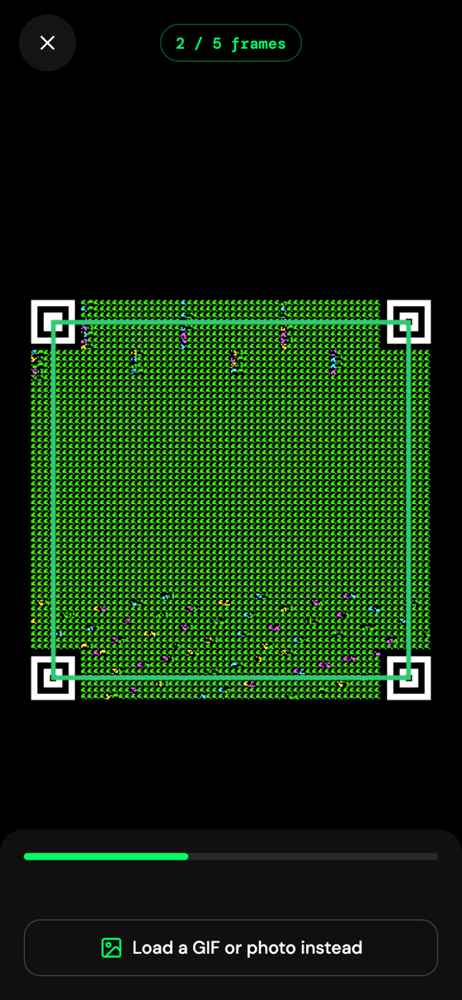
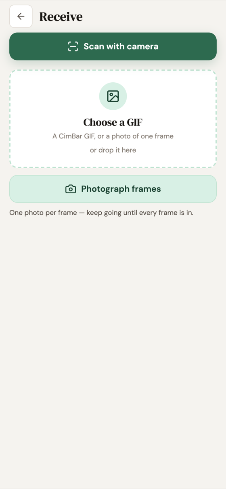
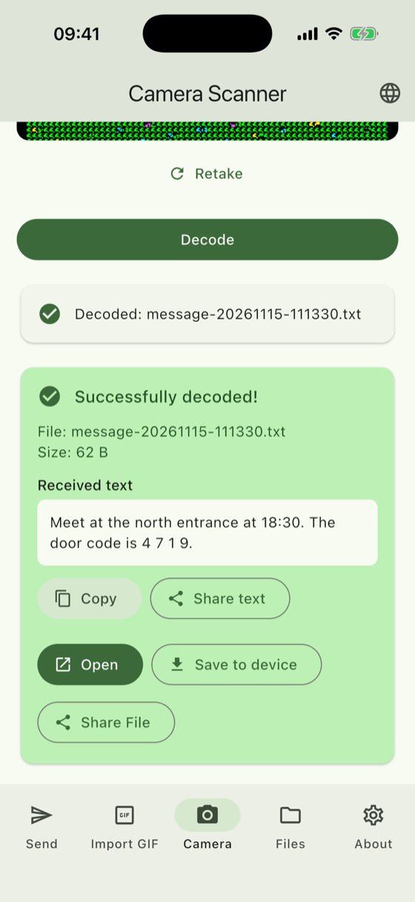
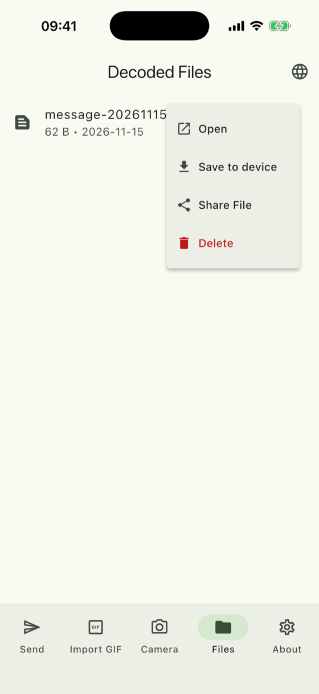
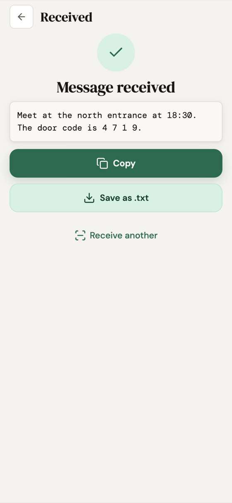

# Odbieranie

Są trzy sposoby odbierania. Każdy kończy się tak samo: plikiem, który możesz otworzyć, zapisać lub udostępnić, albo wiadomością tekstową, którą możesz skopiować.

## Skanowanie aparatem (zalecane)

W ten sposób odbierasz kod, który ktoś pokazuje na ekranie.

**W aplikacji:** otwórz kartę **Aparat** i dotknij **Skanowanie na żywo**. **W aplikacji internetowej:** otwórz **Odbierz**. Aparat uruchomi się od razu.

1. Umieść kod kreskowy w kwadracie.
2. Postępuj zgodnie ze wskazówkami: **Podejdź bliżej**, **Odsuń się**, **Nie ruszaj telefonem**, **Zmień kąt lub oświetlenie**.
3. Licznik pokazuje, ile klatek już dotarło. Gdy osiągnie łączną liczbę, plik się otworzy.

Klatki mogą przychodzić w dowolnej kolejności, a przegapione klatki nie mają znaczenia: nadają się dowolne klatki pliku, byle było ich wystarczająco dużo.

{ width="280" }
{ width="280" }

## Import GIF-a

Gdy ktoś udostępnił Ci GIF CimBar:

- **Aplikacja:** otwórz kartę **Otwórz GIF** i użyj **Wybierz plik** albo udostępnij GIF z innej aplikacji prosto do CimBar (menu udostępniania na Androidzie lub arkusz udostępniania na iPhonie).
- **Aplikacja internetowa:** w sekcji **Odbierz** użyj **Wybierz GIF** (lub upuść go na stronę).

## Zdjęcie klatki

- **Aplikacja:** na karcie **Aparat** dotknij **Zrób zdjęcie** albo wybierz istniejące zdjęcie przyciskiem **Galeria**. Zdjęcie mieści jedną klatkę, więc działa to tylko dla kodów jednoklatkowych. Przy dłuższym kodzie aplikacja poprosi o użycie funkcji **Skanowanie na żywo**.
- **Aplikacja internetowa:** **Fotografuj klatki** przyjmuje jedno zdjęcie na klatkę i zbiera je, dopóki nie dotrą wszystkie klatki. Przyjmuje też zdjęcie klatki przez **Wybierz GIF**.

Jeśli zdjęcie należy do innego pliku niż ten, który zbierasz, aplikacja internetowa zapyta, zanim zacznie od nowa.

{ width="280" }

## Zaszyfrowane pliki

Jeśli plik został zaszyfrowany, po dotarciu wszystkich klatek zostaniesz poproszony o hasło. Nie trzeba skanować ponownie: jeśli wpiszesz błędne hasło, po prostu wpisz je jeszcze raz. Zobacz [Szyfrowanie](encryption.md).

## Gdzie trafiają odebrane pliki

**Aplikacja:** odebrany plik jest przechowywany w aplikacji i widoczny na karcie **Pliki**. Stamtąd użyj **Otwórz**, aby otworzyć go w innej aplikacji, **Zapisz na urządzeniu**, udostępnij go albo użyj **Usuń**. Wiadomość tekstowa jest wyświetlana z przyciskami **Kopiuj** i **Udostępnij tekst**. Odinstalowanie aplikacji usuwa przechowywane przez nią pliki, więc zapisz te, których potrzebujesz.

**Aplikacja internetowa:** nic nie jest pobierane automatycznie. Wybierz **Zapisz na urządzeniu**, **Otwórz** (dla typów plików, które można bezpiecznie wyświetlić) lub **Udostępnij**. Wiadomość tekstowa jest wyświetlana z przyciskami **Kopiuj** i **Zapisz jako .txt**.

{ width="220" }
{ width="220" }
{ width="220" }
