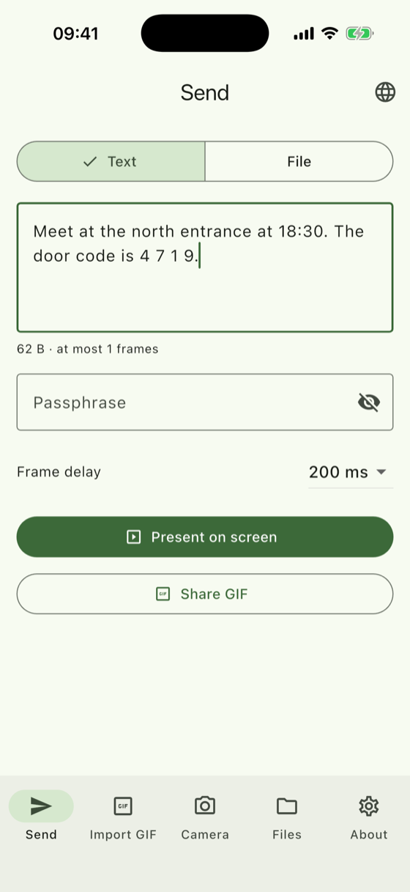
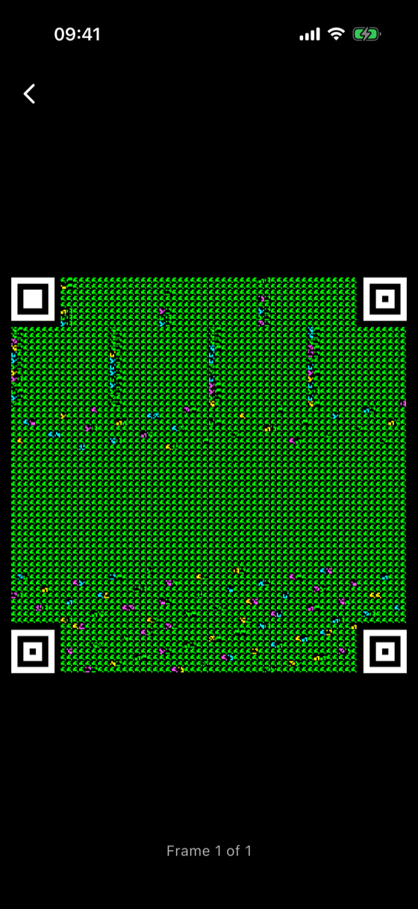
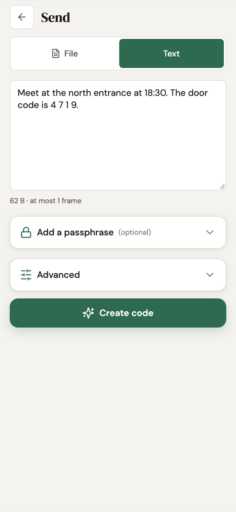
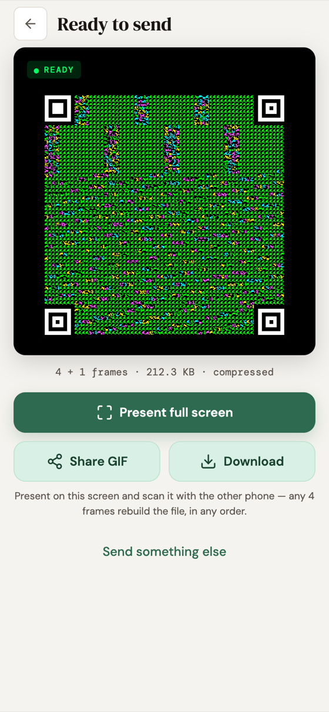

# Wysyłanie pliku lub tekstu

Wysyłanie zamienia plik lub wiadomość w animowany kod: sekwencję klatek, z których każda jest siatką kolorowych kształtów. Pokaż go na pełnym ekranie i pozwól drugiemu urządzeniu go zeskanować albo udostępnij go jako GIF.

## W aplikacji (Android, iPhone)

1. Otwórz kartę **Wyślij**.
2. Wybierz **Tekst** i wpisz lub wklej wiadomość albo wybierz **Plik** i wskaż plik.
3. Opcjonalnie: wpisz **Hasło**. Odbiorca będzie go potrzebował, aby otworzyć to, co wysyłasz. Zobacz [Szyfrowanie](encryption.md).
4. Opcjonalnie: zmień **Opóźnienie klatki**: 100, 200 lub 400 ms na klatkę. Wolniej jest łatwiej dla aparatu odbiorcy; szybciej kończy się wcześniej.
5. Dotknij **Pokaż na ekranie**, aby wyświetlić kod na pełnym ekranie, lub **Udostępnij GIF**, aby wysłać go jako animowany GIF przez inną aplikację.

Wiersz pod polem wprowadzania pokazuje rozmiar i maksymalną liczbę klatek, jaką będzie miał kod.

Podczas pokazu aplikacja utrzymuje włączony ekran i zwiększa jasność. Oba ustawienia wracają do normy, gdy go opuścisz.

{ width="280" }
{ width="280" }

## W aplikacji internetowej

1. Otwórz **Wyślij**.
2. Wybierz **Plik** (wskaż lub upuść plik) albo **Tekst** (wpisz wiadomość).
3. Opcjonalnie: **Dodaj hasło**.
4. Opcjonalnie: w sekcji **Zaawansowane** wybierz **Szybkość klatek**.
5. Dotknij **Utwórz kod**. Na ekranie **Gotowe do wysłania** wybierz **Pokaż na pełnym ekranie**, **Udostępnij GIF** (na telefonach obsługujących udostępnianie) lub **Pobierz**.

{ width="280" }
{ width="280" }

## Niech kod się wyświetla

Pokazywany kod najpierw raz wyświetla każdą klatkę pliku, a potem bez końca pokazuje *klatki naprawcze*. Odbiorca potrzebuje tylu klatek, ile ma plik, i nadaje się każda z nich. Przegapioną klatkę zastępuje ta, która pojawi się następna, więc nie trzeba czekać, aż pętla wróci do początku. Po prostu trzymaj kod na ekranie, dopóki odbiorca nie powie, że skończył.

GIF zawiera klatki pliku oraz mniej więcej o jedną czwartą więcej klatek naprawczych, więc odbiorca może w każdym przebiegu przegapić kilka klatek.

## Jak duży może być plik?

Każda klatka niesie około 2 KB. CimBar kompresuje to, co wysyłasz, gdy tylko zmniejsza to rozmiar, więc tekst zwykle potrzebuje mniej klatek, niż sugerowałby jego rozmiar.

- Małe pliki (do około 80 KB) są najszybsze: kilkadziesiąt klatek.
- **Pokaż na ekranie** obsługuje do 4096 klatek.
- **Udostępnij GIF** w aplikacji jest ograniczone do 500 klatek.

Duże pliki działają, ale ich skanowanie trwa dłużej. Dla kodów mających więcej niż około 100 klatek wybierz wolniejszą szybkość klatek.
