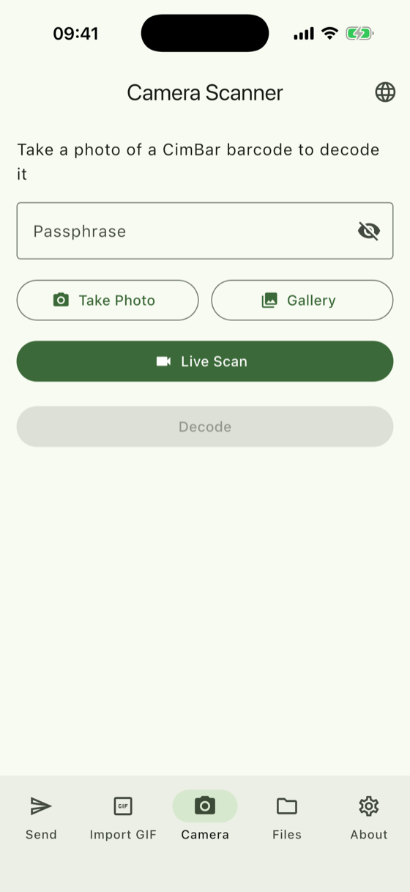
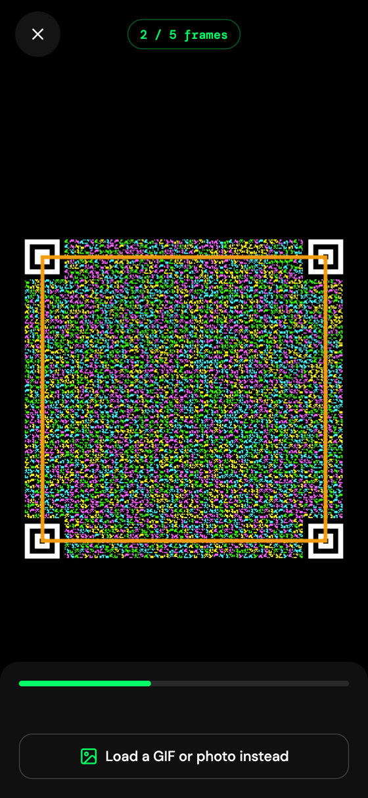
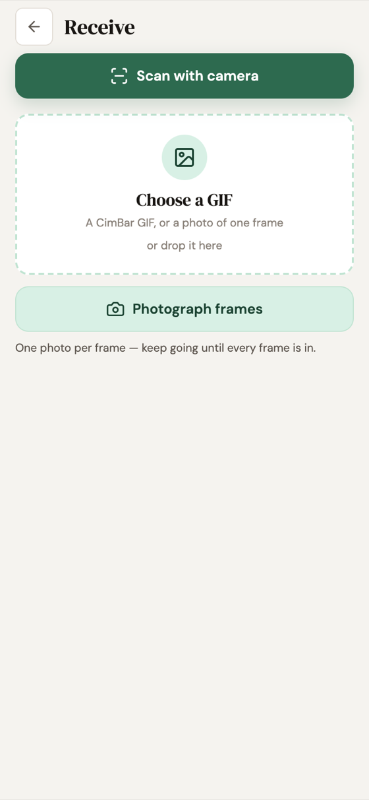
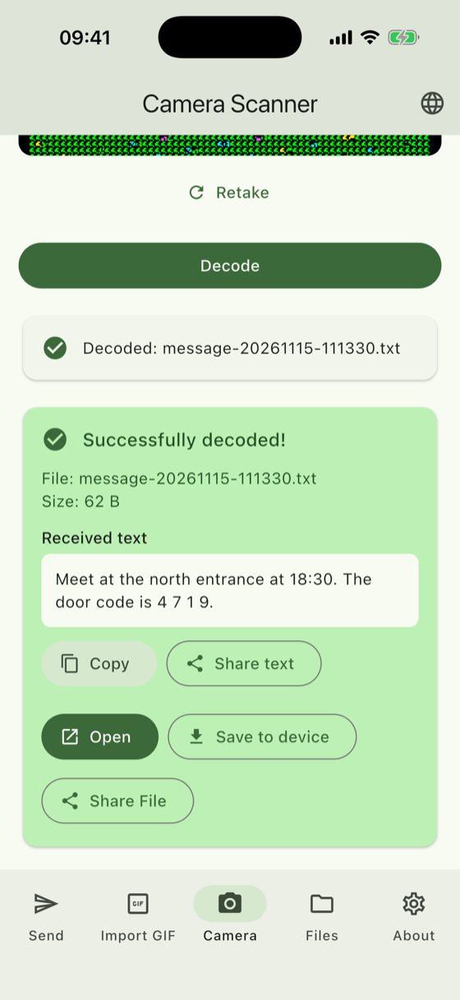
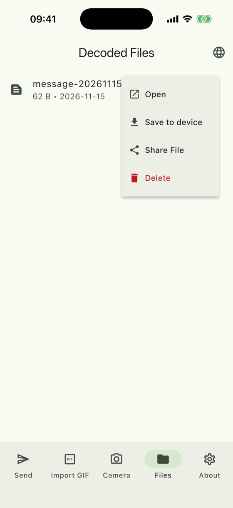
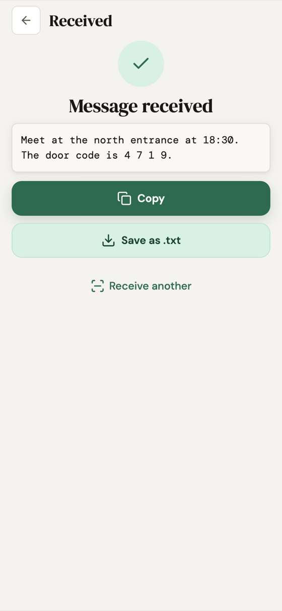

# Приём

Принять можно тремя способами. Каждый заканчивается одинаково: файлом, который можно открыть, сохранить или переслать, или текстовым сообщением, которое можно скопировать.

## Сканирование камерой (рекомендуется)

Так принимают код, который кто-то показывает на экране.

**В приложении:** откройте вкладку **Камера** и нажмите **Живое сканирование**. **В веб-приложении:** откройте **Получить**. Камера включится сразу.

1. Поместите штрихкод внутрь квадрата.
2. Следуйте подсказкам: **Поднесите ближе**, **Отодвиньте дальше**, **Держите неподвижно**, **Измените угол или освещение** (в веб-приложении: **Держите камеру прямо напротив экрана**).
3. Счётчик показывает, сколько кадров уже собрано. Когда он дойдёт до общего числа, файл откроется.

Кадры могут приходить в любом порядке, а пропущенные не имеют значения: подойдут любые кадры файла, лишь бы их было достаточно.

{ width="280" }
{ width="280" }

## Импорт GIF

Если с вами поделились GIF-файлом CimBar:

- **Приложение:** откройте вкладку **Импорт GIF** и нажмите **Выбрать файл** или отправьте GIF из другого приложения прямо в CimBar (через меню «Поделиться» на Android или на iPhone).
- **Веб-приложение:** в разделе **Получить** нажмите **Выберите GIF** (или перетащите файл на страницу).

## Фотография кадра

- **Приложение:** на вкладке **Камера** нажмите **Сделать фото** или выберите снимок в **Галерея**. На фотографии помещается один кадр, поэтому так можно принять только код из одного кадра. Для более длинного кода приложение предложит **Живое сканирование**.
- **Веб-приложение:** **Снять кадры** принимает по одной фотографии на кадр и продолжает собирать, пока не соберутся все кадры. Фотографию кадра можно добавить и через **Выберите GIF**.

Если фотография относится к другому файлу, а не к тому, который сейчас собирается, веб-приложение спросит, прежде чем начать заново.

{ width="280" }

## Зашифрованные файлы

Если файл зашифрован, пароль спросят, когда соберутся все кадры. Сканировать заново не нужно: если пароль введён неверно, просто введите его ещё раз. См. [Шифрование](encryption.md).

## Куда попадают принятые файлы

**Приложение:** принятый файл хранится в приложении и виден на вкладке **Файлы**. Оттуда его можно **Открыть** в другом приложении, **Сохранить на устройство**, переслать или **Удалить**. Текстовое сообщение показывается с кнопками **Копировать** и **Поделиться текстом**. При удалении приложения удаляются и сохранённые в нём файлы, поэтому сохраните нужные заранее.

**Веб-приложение:** ничего не скачивается автоматически. Выберите **Сохранить файл**, **Открыть** (для типов файлов, которые безопасно показывать) или **Поделиться**. Текстовое сообщение показывается с кнопками **Копировать** и **Сохранить как .txt**.

{ width="220" }
{ width="220" }
{ width="220" }
