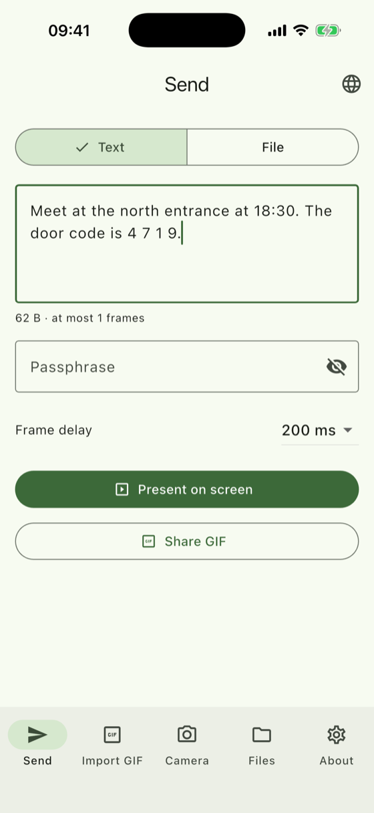
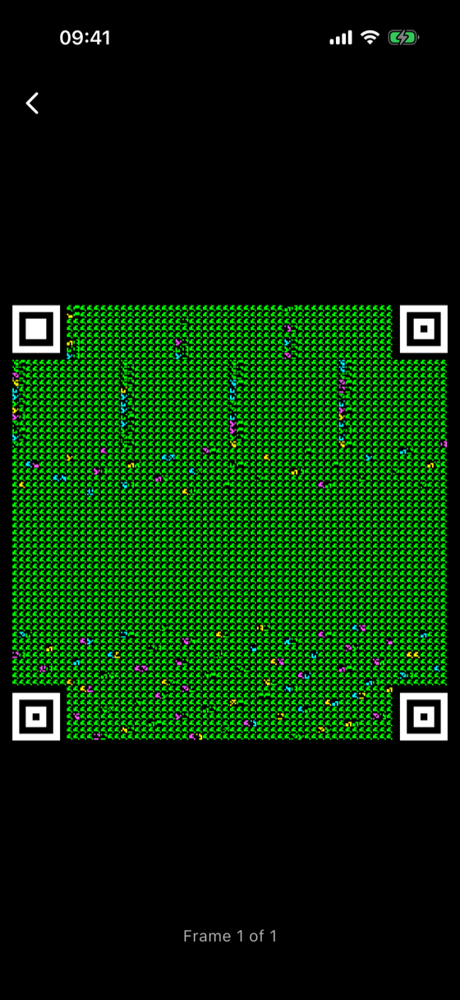
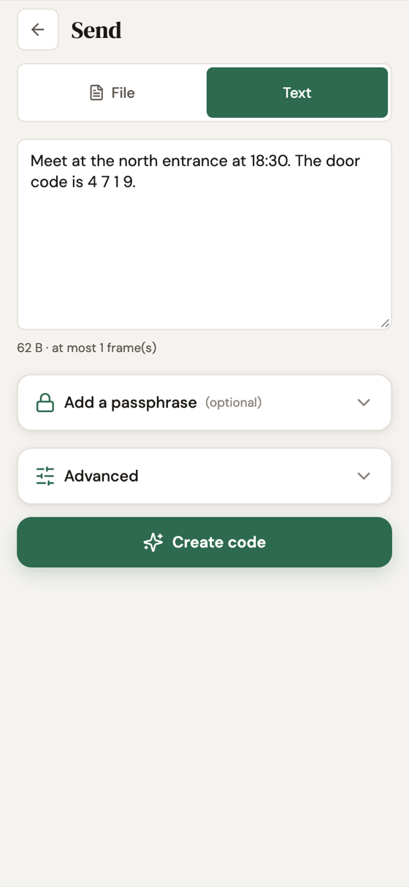
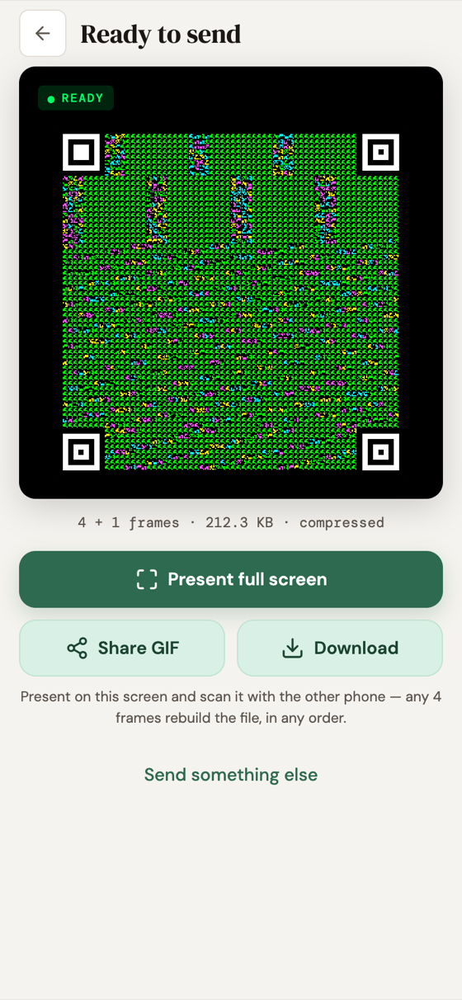

# Отправка файла или текста

При отправке файл или сообщение превращается в анимированный код — последовательность кадров, каждый из которых представляет собой сетку цветных фигур. Покажите его на весь экран и дайте другому устройству отсканировать его или поделитесь им как GIF.

## В приложении (Android, iPhone)

1. Откройте вкладку **Отправить**.
2. Выберите **Текст** и наберите или вставьте сообщение либо выберите **Файл** и укажите файл.
3. По желанию: введите **Пароль**. Он понадобится получателю, чтобы открыть отправленное. См. [Шифрование](encryption.md).
4. По желанию: измените **Задержка кадра** — 100, 200 или 400 мс на кадр. Медленнее — легче для принимающей камеры, быстрее — раньше закончите.
5. Нажмите **Показать на экране**, чтобы вывести код на весь экран, или **Поделиться GIF**, чтобы отправить его как анимированный GIF через другое приложение.

Строка под полем ввода показывает размер и максимальное число кадров в коде.

Во время показа приложение не даёт экрану погаснуть и повышает яркость. Когда вы выходите, всё возвращается как было.

{ width="280" }
{ width="280" }

## В веб-приложении

1. Откройте **Отправить**.
2. Выберите **Файл** (укажите или перетащите файл) или **Текст** (наберите сообщение).
3. По желанию: **Добавить пароль**.
4. По желанию: в разделе **Дополнительно** выберите **Скорость кадров**.
5. Нажмите **Создать код**. На экране **Готово к отправке** выберите **Показать на весь экран**, **Поделиться** (на телефонах, которые это поддерживают) или **Скачать**.

{ width="280" }
{ width="280" }

## Не останавливайте показ

Показываемый код сначала один раз проходит по всем кадрам файла, а затем без конца показывает *ремонтные кадры*. Получателю нужно столько кадров, сколько их в файле, причём подойдут любые. Пропущенный кадр восполняет следующий, поэтому ждать нового круга не нужно. Просто держите код на экране, пока получатель не скажет, что всё готово.

GIF содержит кадры файла и ещё примерно четверть сверху ремонтных кадров, поэтому получатель может пропустить несколько кадров за каждый проход.

## Какой может быть размер?

Каждый кадр несёт около 2 КБ. CimBar сжимает отправляемое, когда это уменьшает размер, поэтому тексту обычно нужно меньше кадров, чем можно подумать по его размеру.

- Небольшие файлы (примерно до 80 КБ) передаются быстрее всего — за несколько десятков кадров.
- **Показать на экране** справляется с кодами до 4096 кадров.
- **Поделиться GIF** в приложении ограничено 500 кадрами.

Большие файлы тоже передаются, но сканировать их приходится дольше. Для кодов длиннее примерно 100 кадров выбирайте скорость помедленнее.
