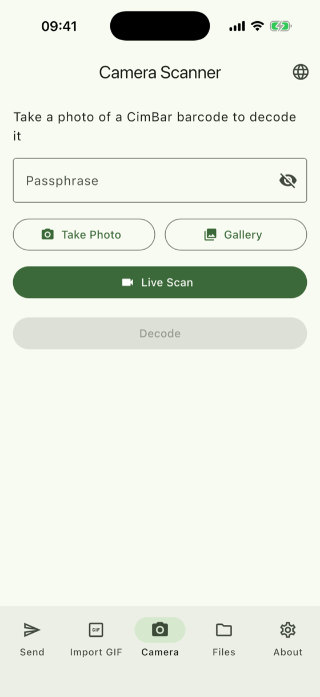
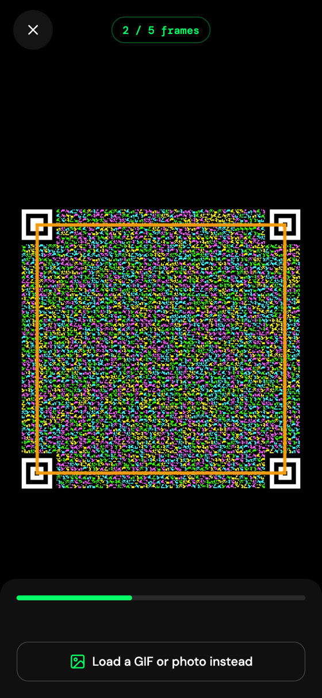
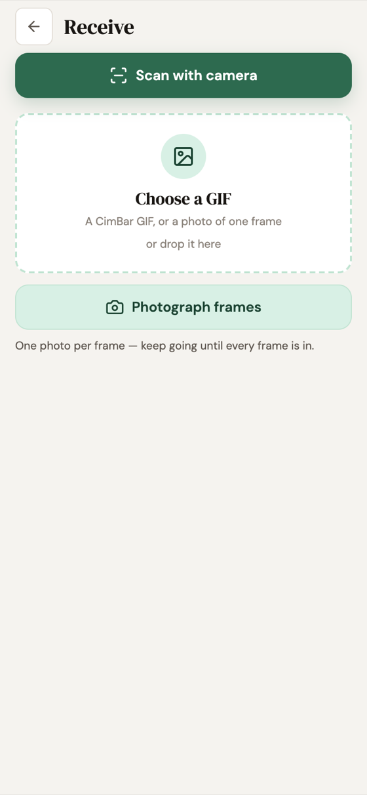
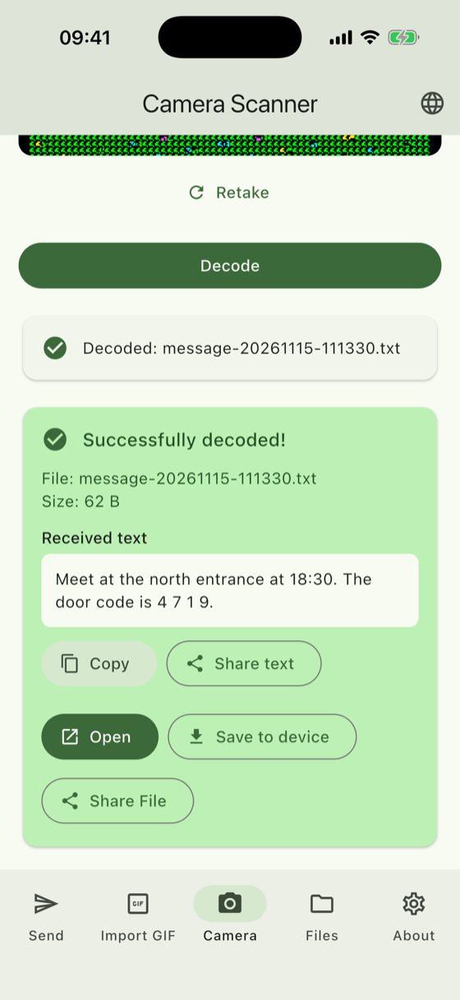
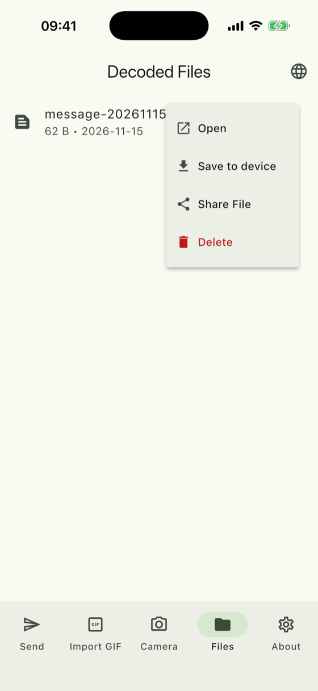
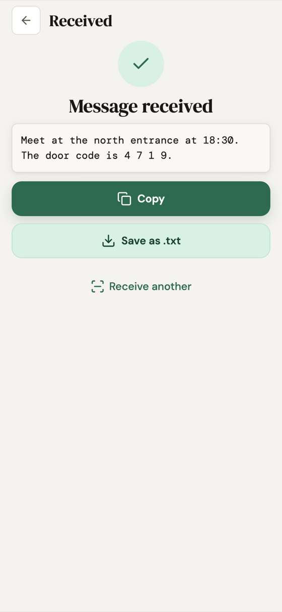

# Отримати

Отримати можна трьома способами. Кожен із них закінчується однаково: файлом, який можна відкрити, зберегти чи поширити, або текстовим повідомленням, яке можна скопіювати.

## Сканування камерою (рекомендовано)

Так отримують код, який хтось показує на екрані.

**У застосунку:** відкрийте вкладку **Камера** й натисніть **Живе сканування**. **У вебзастосунку:** відкрийте **Отримати**. Камера одразу вмикається.

1. Розмістіть штрихкод усередині квадрата.
2. Дотримуйтеся підказок: **Піднесіть ближче**, **Відсуньте далі**, **Тримайте нерухомо**, **Змініть кут або освітлення** (у вебзастосунку: **Тримайте камеру прямо навпроти екрана**).
3. Лічильник показує, скільки кадрів уже отримано. Коли він досягне загальної кількості, файл відкриється.

Кадри можуть надходити в будь-якому порядку, а пропущені не мають значення: підійдуть будь-які кадри файлу, аби їх було достатньо.

{ width="280" }
{ width="280" }

## Імпорт GIF

Якщо з вами поділилися GIF-файлом CimBar:

- **Застосунок:** відкрийте вкладку **Імпорт GIF** і натисніть **Вибрати файл** або поділіться GIF з іншого застосунку прямо в CimBar (меню «Поділитися» на Android або аркуш поширення на iPhone).
- **Вебзастосунок:** у розділі **Отримати** скористайтеся кнопкою **Виберіть GIF** (або перетягніть файл на сторінку).

## Фото кадру

- **Застосунок:** у вкладці **Камера** натисніть **Зробити фото** або **Галерея**, щоб вибрати готовий знімок. Одне фото містить один кадр, тож цей спосіб працює лише для кодів з одного кадру. Для довшого коду застосунок запропонує **Живе сканування**.
- **Вебзастосунок:** **Зняти кадри** приймає по одному фото на кадр і збирає їх, доки не надійдуть усі кадри. Фото кадру можна також вибрати через **Виберіть GIF**.

Якщо фото належить іншому файлу, ніж той, що збирається зараз, вебзастосунок спершу запитає, чи почати заново.

{ width="280" }

## Зашифровані файли

Якщо файл зашифровано, пароль запитають, коли надійдуть усі кадри. Сканувати знову не треба: якщо ввели пароль неправильно, просто введіть його ще раз. Див. [Шифрування](encryption.md).

## Куди потрапляють отримані файли

**Застосунок:** отриманий файл зберігається в застосунку й з'являється у вкладці **Файли**. Звідти його можна **Відкрити** в іншому застосунку, **Зберегти на пристрій**, поширити або **Видалити**. Текстове повідомлення показується з кнопками **Копіювати** та **Поділитися текстом**. Якщо видалити застосунок, збережені в ньому файли теж зникнуть, тож збережіть потрібні.

**Вебзастосунок:** нічого не завантажується автоматично. Виберіть **Зберегти файл**, **Відкрити** (для типів файлів, які безпечно показувати) або **Поділитися**. Текстове повідомлення показується з кнопками **Копіювати** та **Зберегти як .txt**.

{ width="220" }
{ width="220" }
{ width="220" }
